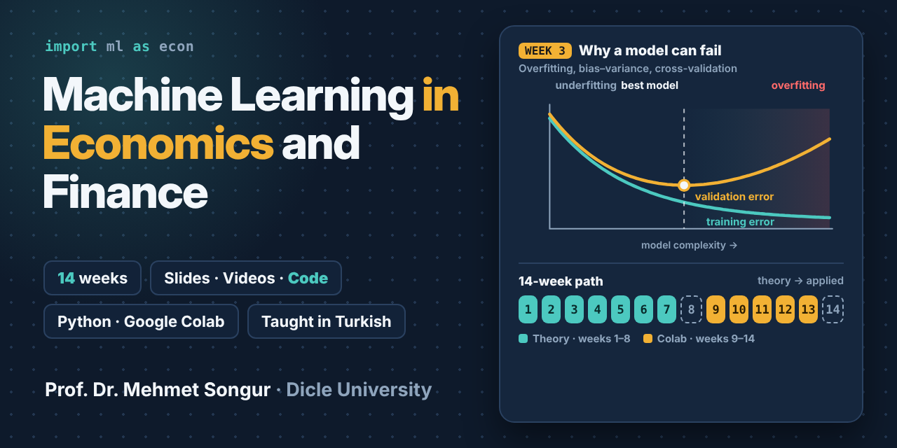

# Machine Learning in Economics and Finance

Weekly materials for the 14-week course **Machine Learning in Economics and Finance** at Dicle University: slides, lecture videos and code. The course is taught in Turkish.

**Course page (Turkish):** https://www.songurmehmet.com/dersler/ekonomi-ve-finansta-makine-ogrenmesi.html

🇹🇷 *Dersin Türkçe sayfası için yukarıdaki bağlantıya tıklayın; slaytlar ve videolar Türkçedir.*

**Format:** a theory block (weeks 1–8) followed by an applied block in Google Colab (weeks 9–14). Slides, videos and code are added to each week as they are published.

**Code for the theory weeks:** each notebook reproduces the simulations behind the figures and tables in that week's lecture notes and slides (simulated data, fixed random seeds, so the numbers match the course materials). The notebooks are in Turkish and run in Google Colab with no installation; locally they need `numpy`, `pandas`, `matplotlib` and `scikit-learn`.

*Last updated: 1 November 2026*

## Theory block

| Week | Topic | Slides | Video | Code |
|:--:|---|:--:|:--:|:--:|
| 1 | Artificial intelligence, machine learning and deep learning; how they differ from econometrics (prediction vs. causality) | [PDF](https://www.songurmehmet.com/assets/dersler/ml/Hafta01_Slaytlar.pdf) | [Watch](https://youtu.be/NK_xTGsUph8) | [Notebook](code/Hafta01_Katsayi_ve_Ongoru.ipynb) · [Colab](https://colab.research.google.com/github/mehmetsongur/Machine-Learning-in-Economics-and-Finance/blob/main/code/Hafta01_Katsayi_ve_Ongoru.ipynb) |
| 2 | Types of learning, features and target, data types, data preparation concepts | [PDF](https://www.songurmehmet.com/assets/dersler/ml/Hafta02_Slaytlar.pdf) | [Watch](https://www.youtube.com/watch?v=epkgrEX1N7Q) | [Notebook](code/Hafta02_Veri_Hazirlama.ipynb) · [Colab](https://colab.research.google.com/github/mehmetsongur/Machine-Learning-in-Economics-and-Finance/blob/main/code/Hafta02_Veri_Hazirlama.ipynb) |
| 3 | Model performance: overfitting, bias–variance, cross-validation, data leakage | [PDF](https://www.songurmehmet.com/assets/dersler/ml/Hafta03_Slaytlar.pdf) | [Watch](https://youtu.be/TzWIzMklU9Q) | [Notebook](code/Hafta03_Model_Basarisi.ipynb) · [Colab](https://colab.research.google.com/github/mehmetsongur/Machine-Learning-in-Economics-and-Finance/blob/main/code/Hafta03_Model_Basarisi.ipynb) |
| 4 | Regression and regularization: OLS, Ridge, Lasso | — | — | [Notebook](code/Hafta04_Ridge_ve_Lasso.ipynb) · [Colab](https://colab.research.google.com/github/mehmetsongur/Machine-Learning-in-Economics-and-Finance/blob/main/code/Hafta04_Ridge_ve_Lasso.ipynb) |
| 5 | Classification: logistic regression, confusion matrix, ROC-AUC, imbalanced data | — | — | — |
| 6 | Trees and ensemble methods (random forest, boosting); interpretability (SHAP) | — | — | — |
| 7 | Unsupervised learning and text analysis: k-means, PCA; turning text into numbers (bag of words, TF-IDF), dictionary-based tone measurement, intuition for topic modelling, text classification with LLMs | — | — | — |
| 8 | Midterm exam | | | |

## Applied block (Google Colab)

| Week | Topic | Slides | Video | Code |
|:--:|---|:--:|:--:|:--:|
| 9 | Introduction to Colab and Python; pulling data from EVDS (CBRT) and FRED | — | — | — |
| 10 | Inflation forecasting: OLS and Lasso | — | — | — |
| 11 | Credit risk: logistic regression, random forest and XGBoost; interpretation with SHAP | — | — | — |
| 12 | Financial time series: exchange rate or BIST returns, time-based validation | — | — | — |
| 13 | Text analysis: CBRT Monetary Policy Committee decision texts → TF-IDF → k-means period clusters; building a tone score and comparing it with the policy rate; classifying the same texts with an LLM and comparing with the dictionary method | — | — | — |
| 14 | Project presentations | | | |

## Author

**Prof. Dr. Mehmet Songur** 
Department of Economics, Faculty of Economics and Administrative Sciences 
Dicle University · Diyarbakır, Türkiye 
Areas of specialisation: economics, macroeconomics, econometrics, applied AI

### Academic Profiles

-  [Google Scholar](https://scholar.google.com.tr/citations?user=aIydQBUAAAAJ&hl=en)
-  [ORCID](https://orcid.org/0000-0003-4763-9314)
-  [Scopus](https://www.scopus.com/authid/detail.uri?authorId=57211849417)
-  [Web of Science](https://www.webofscience.com/wos/author/record/ABI-2540-2020)

### Links

- 🌐 [songurmehmet.com](https://songurmehmet.com)
- 𝕏 [X](https://x.com/mehmetsongur_)
-  [LinkedIn](https://tr.linkedin.com/in/mehmetsongur)
-  [YouTube](https://www.youtube.com/channel/UCfeckeM1sASHHl5ZmQ7lqDQ)
-  [Instagram](https://www.instagram.com/mmtsngr/)
-  [Medium](https://medium.com/@mmtsngr)

## License

© 2026 Mehmet Songur. The course materials in this repository are licensed under [Creative Commons Attribution-NonCommercial-NoDerivatives 4.0 International (CC BY-NC-ND 4.0)](https://creativecommons.org/licenses/by-nc-nd/4.0/).

You may share and link to them in teaching, with attribution to the author. Commercial use and modified versions are not permitted.

Third-party material included in the slides (figures, tables, data) is excluded from this license and remains subject to its own terms.

The code in the [`code/`](code/) folder (Jupyter notebooks) is licensed separately under the [MIT License](code/LICENSE): you may use, adapt and redistribute it, including in your own courses, provided the copyright notice is kept.
